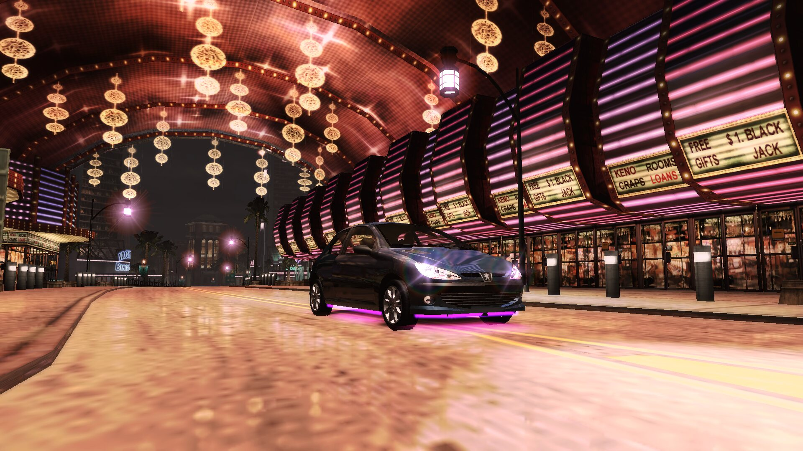
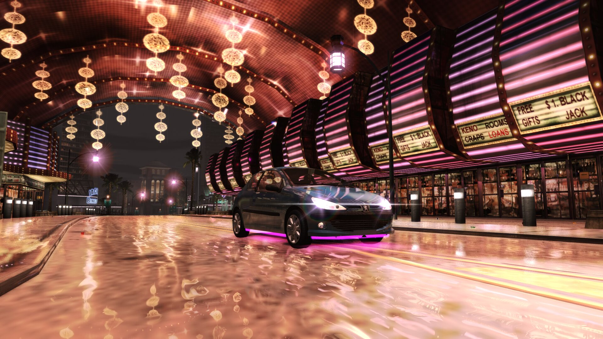

# Overbright

Reimplementation of **Need for Speed: Underground 2** (2004) in Rust and wgpu.

Written from scratch, it plays the game from your own installed copy, behaves like the original by default,
and adds modern resolutions, any frame rate and optional graphics upgrades on top.

**[Download for Linux and Windows](https://github.com/j0braun/overbright/releases/latest)**

Overbright is not affiliated with Electronic Arts. EA has not endorsed and does not support this product.
"Need for Speed" and "Need for Speed Underground 2" are trademarks of their owner.
No game files are included: you need your own PC copy of the game.

## Highlights

- **The original, exactly.** Menus, career, races, physics, AI, traffic, sound and movies are ported from the
  original's code and checked against `SPEED2.EXE`. Every difference from the original is written down in
  [docs/native-deviations.md](docs/native-deviations.md).
- **Modern displays.** Resolutions up to 4K and ultrawide, high refresh rates and any frame rate. The world
  still updates like the original's 60 Hz, so the game plays the same at 30, 60, 144 or 240 fps.
- **Optional graphics upgrades.** Street lamps that light the world and cast shadows, ambient occlusion,
  screen-space or ray-traced reflections (Vulkan; the traced ones show textured scenery, neon signs and the
  street lamps' and cars' light glows on wet roads), volumetric fog and rain, supersampling up to 16×,
  upscaling. Each is off until you switch it on, and Restore Native goes back in one step.
- **A launcher.** Finds and checks your game, prepares the shaders in the background, sets up texture
  mods and the HD HUD mod you already have, and can skip the intro movies and the title screen (each on its
  own) so the game starts straight into the menus.
- **Linux and Windows**, with ready-made builds for both.

## Screenshots

The same places at 1920×1080, at night in rain: the Original preset (left) and every graphics option at its
top value (right: ray-traced reflections and shadows, Modern Lighting + RT, 16× supersampling, High Precision
Post with the full-size glow, volumetric fog, wet roads, rain detail, Ambient Detail). No mods or texture
packs; the HUD is hidden.

| Original | Every option at maximum |
|---|---|
|  |  |
|  |  |
|  |  |

## Getting started

1. Install the PC version of Need for Speed Underground 2 from your disc (any region) and patch it to version 1.2.
2. Download the archive for your system from [Releases](https://github.com/j0braun/overbright/releases) and
   unpack it anywhere.
3. Start `overbright` (`overbright.exe` on Windows). It finds the game or asks for its folder. Press Play.

The launcher is optional: `game --check-game <folder>` checks a game folder, and `game` starts the game
directly ([docs/launcher.md](docs/launcher.md)). Building from source: [BUILDING.md](BUILDING.md).

## Requirements

| | Linux | Windows |
|---|---|---|
| System | 64-bit x86 (x86-64), glibc 2.28 or newer, X11 or Wayland | Windows 10 or 11, 64-bit. Experimental: tested under Wine, not yet on real hardware |
| Graphics | The Vulkan loader and a Vulkan driver: Mesa 22 or newer for AMD and Intel graphics, or NVIDIA's own driver | A Vulkan driver (Direct3D 12 is a fallback, untested) |
| Sound | PipeWire, PulseAudio or ALSA | Built in |

The game: your own install of Need for Speed Underground 2 for PC from any disc release, patched to version 1.2,
of any region. Overbright reads the game's data files (models, textures, sounds, text, tracks); it does not
run or read `SPEED2.EXE`, so the copy-protected disc executable is fine, and the folder works without an
executable too. The engine's own numbers are part of Overbright ([docs/exe-tables.md](docs/exe-tables.md)). The region is taken from the installed car folders
([docs/region.md](docs/region.md)).

On Linux without a Vulkan driver, the launcher and the game say which package to install (Ubuntu, Debian, Mint:
`sudo apt install libvulkan1 mesa-vulkan-drivers`; Fedora: `sudo dnf install vulkan-loader mesa-vulkan-drivers`;
Arch, SteamOS: `vulkan-icd-loader` with `vulkan-radeon` or `vulkan-intel`).

The Linux archive was run in a container of each of these distributions, on Mesa's software Vulkan driver
(lavapipe; no real GPUs): `--version`, the game check, the menu and free roam drawn, the launcher
([docs/building-releases.md](docs/building-releases.md), "Linux: what a player needs").

| distribution | glibc | Mesa | result |
|---|---|---|---|
| Ubuntu 22.04, 24.04 | 2.35, 2.39 | 23.2, 25.2 | works |
| Linux Mint 22 | 2.39 | 25.2 | works |
| Debian 12, 13 | 2.36, 2.41 | 22.3, 25.0 | works |
| Fedora 40, 41, 45 | 2.39, 2.40, 2.44 | 24.1, 25.0, 26.2 | works |
| AlmaLinux 9 (RHEL 9 family) | 2.34 | 25.2 | works |
| Arch (stands in for SteamOS) | 2.44 | 26.2 | works |
| openSUSE Leap 15.6, Tumbleweed | 2.38, 2.44 | 23.3, 26.2 | works |
| Ubuntu 20.04, Debian 11 | 2.31 | 21.2, 20.3 | starts, checks the game, the launcher runs; that Mesa's software driver cannot draw the game (needs Mesa 22) |
| AlmaLinux 8 (RHEL 8 family) | 2.28 | 23.1 | starts, checks the game, the launcher runs; its software driver does not start, so drawing was not tested |

## What is in

The front end from the game's own menus, fonts and text; Career, Quick Race (every race type and Free Run),
Customize, options, EA Trax, credits and profiles in the original's save format. Bayview in free roam with
traffic, events, shops, outruns, sponsors and the ending; replays. Automatic and manual gearboxes, keyboard,
mouse and controllers. A portable mode that keeps everything beside the program (below).

## Known issues

Each item says what you notice, when, and whether there is a way around it. Every deliberate difference from the
original, with its switch, is in [docs/native-deviations.md](docs/native-deviations.md).

**Platforms and setup**

- **Windows was tested only under Wine on Linux**, never on a Windows PC. On Windows, Vulkan is used first;
  Direct3D 12 is tried only when no Vulkan driver opens, and it is untested: under Wine it opens but draws
  nothing (Wine's shader compiler rejects the shaders). If the game shows no picture on Windows, update the
  graphics driver so that Vulkan is available.
- **On some Windows 11 PCs the launcher closes a second after it opens**
  ([#19](https://github.com/j0braun/overbright/issues/19)). The cause is not known yet. The launcher writes
  `launcher.log` in the settings folder from its first line (see "Reporting a problem"); please attach it to
  the issue.
- **One edition of the game's data was tested:** the European PC 1.2 release with English game files.
  A North American install is recognised by its CARS folder and gets that region's car lists, shared
  textures, credits and Best Buy code ([docs/region.md](docs/region.md)), but no North American install was
  tried. Other languages start; their data is reported as "unknown" by `game --check-game`. Overbright
  carries the European PC 1.2 release's engine numbers; whether another release's executable used different
  ones is not known.
- **Controllers** were tested with a virtual Xbox 360 pad only. Rumble, PlayStation and Switch pads and the
  Steam Deck's controls were not tried on real hardware.

**Not in the game**

- **Online and LAN:** the menus are there, as in the original. Online shows the original's offline message;
  LAN's "Looking for LAN servers" search finds no games. There is no multiplayer of any kind. (Split
  screen has no menu entry in the original PC game either.)

**Deliberate changes you will notice**

- **The first start opens a 1280×960 window**, not a full screen at the desktop's resolution. Pick the size and
  full screen in the launcher's first screen or in the game's Display options.
- **Enter skips every movie and in-game scene.** The original has its own skip rule for each; there is no switch
  back to those rules yet.

**Differences from the original that are still open**

- **Random choices:** rivals' line-ups and cars, traffic and outrun encounters follow the original's rules, and
  most random draws happen at the original's places in its order, but not all of them (some car-set-up,
  traffic-fill and audio draws). So the same save does not give the same picks the original would give;
  the odds are the same.
- **Physics after a wall hit:** from the same start, your car stays within a few centimetres of the original's
  path through braking, cornering, handbrake turns and launches. Held against a wall it turns off the wall the
  same way as in the original, but can leave it a few seconds sooner or later.
- **Saves:** a save of the original from any career stage, loaded and saved again in Overbright, comes out byte
  for byte as the original's own load-and-save leaves it, and the original loads Overbright's saves. A save
  made after a long session played in Overbright was not loaded back into the original in the last check.

**Performance**

- **The F3 performance overlay's system rows** (CPU and GPU load, clocks, temperatures, memory) show "n/a" on
  Windows. On Linux the GPU rows read AMD GPUs; Intel GPUs show "n/a" and NVIDIA readings are untested.
- **Ray-traced reflections** need a Vulkan GPU with ray queries and about 350–425 MB more video memory at 4K
  than before the ray-tracing rework. In them, cars keep a flat colour, and the wet road's finest ripples are
  a little softer (each frame traces a quarter of the pixels and the rest come from a history). On wet roads
  and cars the rays decide the reflection; railings, foliage and the race-start crowd, which the traced scene
  leaves out, come from the screen where they are visible there.
- Integrated GPUs run the original look well; the heavier upgrades want a dedicated GPU (each option shows
  its cost on the settings page).

A difference from the original that is not listed here or in docs/native-deviations.md is a bug: please
report it.

## Texture mods

Overbright ships no texture art. In the launcher, Mods… adds texture mods you already have: TexMod packages
(`.tpf`), TexWizard packs (a folder with `meta.json` and `textures.bin`, a `.zip` of one, or the packs a
TexWizard install in your game folder loads) and the HD HUD mod (its HUD part, extracted, and its map part). Mods belong to their authors and
stay on your computer; Overbright neither ships nor downloads any
([docs/texture-packs.md](docs/texture-packs.md)).

## Where your files go

| | Linux | Windows |
|---|---|---|
| Settings, logs, crash reports | `~/.local/share/overbright/` | `%LOCALAPPDATA%\Overbright\` |
| Saved games | `~/.local/share/NFS Underground 2/` | `%LOCALAPPDATA%\Overbright\NFS Underground 2\` |
| Cache (rebuilt when missing) | `~/.cache/overbright/` | `%LOCALAPPDATA%\Overbright\cache\` |

Overbright never writes into the game's folder or the original's own save folder
([docs/platform-dirs.md](docs/platform-dirs.md)).

### Portable mode

To keep everything next to the program (a game carried on a portable drive), put an empty file named
`portable.txt` (or a folder named `portable`) beside `overbright` and `game`, or use Make portable on the
launcher's About page. Settings, saved games, the caches, logs, crash reports, screenshots and mods then go to
the folder `data` beside them, and the game folder is remembered relative to the program when it is on the
same drive. The launcher's header then says "Portable". Nothing already kept is moved: to take it along, copy
the contents of the folders in the table above into `data` (saved games into `data/NFS Underground 2`; the cache
can be left behind, it is rebuilt). On Windows the graphics driver's own shader cache stays in its usual place.
Delete `portable.txt` to go back.

## Reporting a problem

Open an issue at [github.com/j0braun/overbright/issues](https://github.com/j0braun/overbright/issues) with the
output of `game --check-game <your game folder>`, the newest log from the logs folder above, and your graphics
settings. If the launcher closes by itself or does not open, attach `launcher.log` from the settings folder
above (it is written from the launcher's first line; the run before is kept as `launcher.old.log`). A difference from the original game is a bug unless it is listed in
[docs/native-deviations.md](docs/native-deviations.md).

## Contributing

Read [CONTRIBUTING.md](CONTRIBUTING.md) first. The short version: the default game must stay exactly the
original; every change is checked against the original's code; nothing from the game or other projects goes
into the repository; and every commit is signed off with `git commit -s`.

Building from source: [BUILDING.md](BUILDING.md). How the code is laid out: [ARCHITECTURE.md](ARCHITECTURE.md).
What is known about the original's files and code, with addresses: [docs/formats.md](docs/formats.md).

## How it was made

Written in Rust by studying the original executable and comparing it with the original running under Wine,
largely together with Claude (Anthropic).

## Licence

GNU General Public License, version 3 or (at your option) any later version: [LICENSE](LICENSE). Third-party
code and its licences: [THIRD-PARTY-NOTICES.md](THIRD-PARTY-NOTICES.md).
