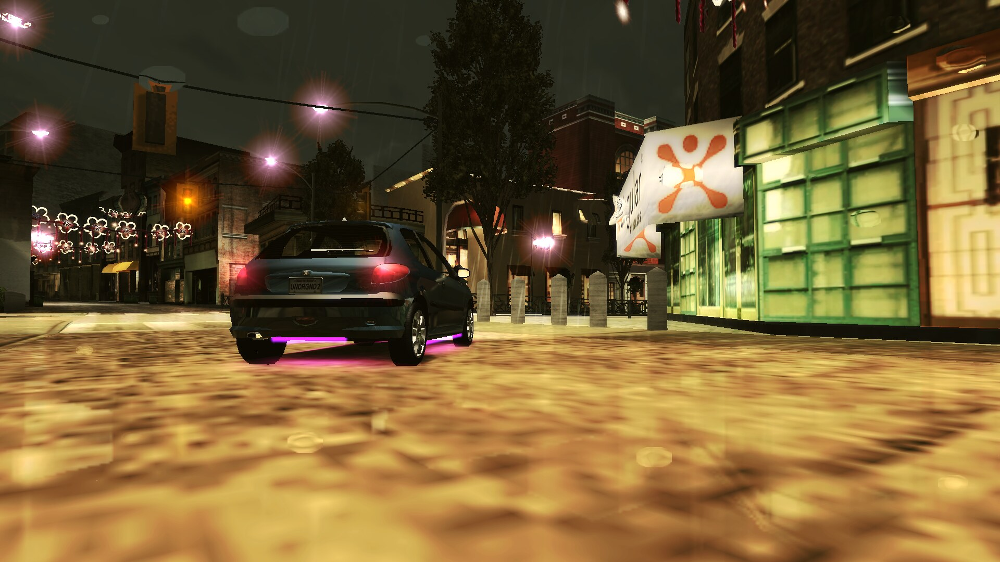
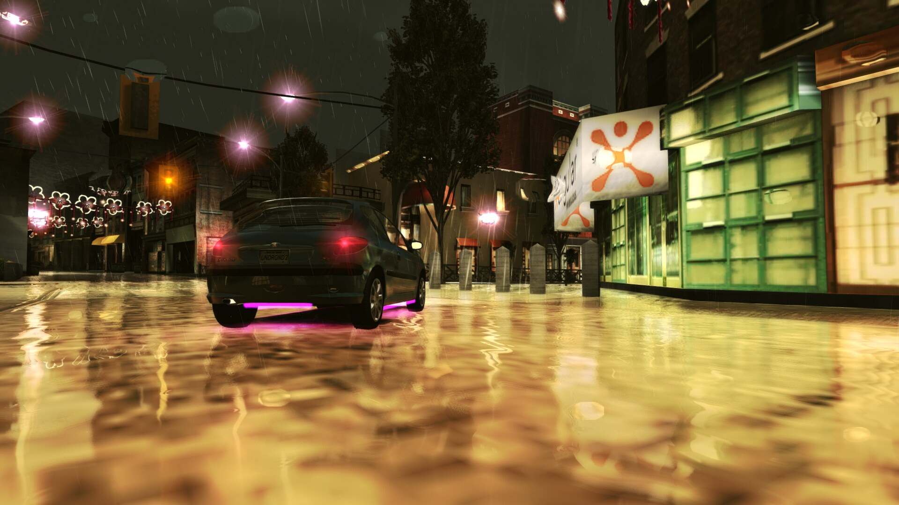
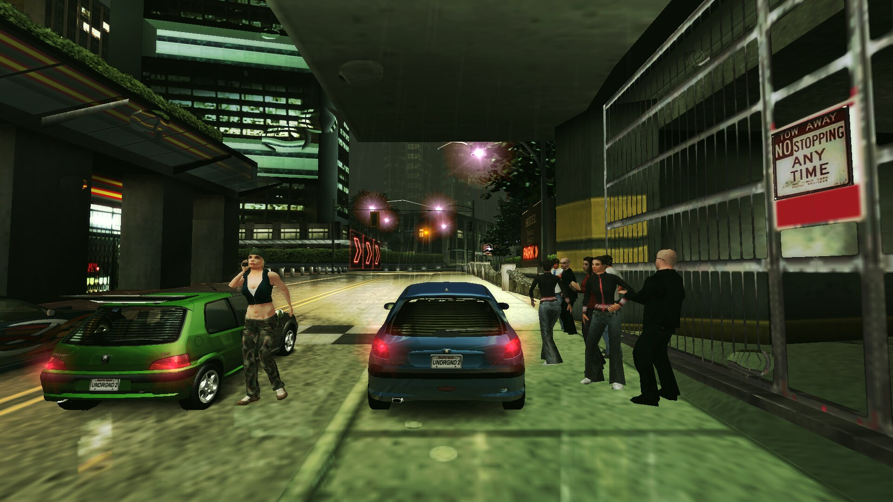
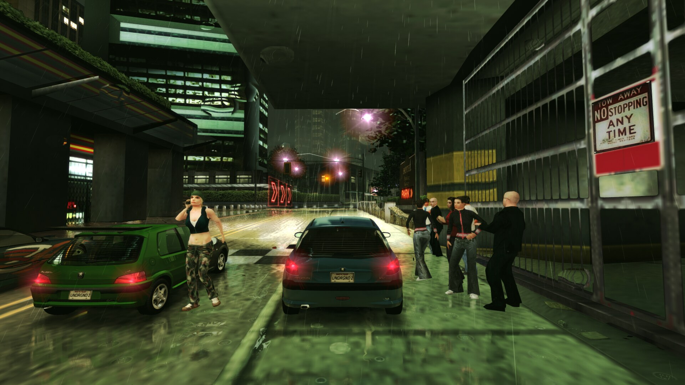

# Overbright

Reimplementation of **Need for Speed: Underground 2** (2004) in Rust and wgpu.

Written from scratch, it plays the game from your own installed copy, behaves like the original by default,
and adds modern resolutions, any frame rate and optional graphics upgrades on top.

**[Download for Linux and Windows](https://github.com/j0braun/overbright/releases/latest)**

Overbright is not affiliated with Electronic Arts. EA has not endorsed and does not support this product.
"Need for Speed" and "Need for Speed Underground 2" are trademarks of their owner.
No game files are included: you need your own PC copy of the game.

## Highlights

- **The original, exactly.** Menus, career, races, physics, AI, traffic, sound and movies are ported from the
  original's code and checked against `SPEED2.EXE`. Every difference from the original is written down in
  [docs/native-deviations.md](docs/native-deviations.md).
- **Modern displays.** Resolutions up to 4K and ultrawide, high refresh rates and any frame rate. The world
  still updates like the original's 60 Hz, so the game plays the same at 30, 60, 144 or 240 fps.
- **Optional graphics upgrades.** Street lamps that light the world and cast shadows, ambient occlusion,
  screen-space or ray-traced reflections (Vulkan), volumetric fog and rain, supersampling up to 16×,
  upscaling. Each is off until you switch it on, and Restore Native goes back in one step.
- **A launcher.** Finds and checks your game, prepares the shaders in the background, and sets up texture
  mods and the HD HUD mod you already have.
- **Linux and Windows**, with ready-made builds for both.

## Screenshots

The same places at 1920×1080, at night in rain: the Original preset (left) and every graphics option at its
top value (right: ray-traced reflections and shadows, Modern Lighting + RT, 16× supersampling, High Precision
Post with the full-size glow, volumetric fog, wet roads, rain detail, Ambient Detail). No mods or texture
packs; the HUD is hidden.

| Original | Every option at maximum |
|---|---|
|  |  |
|  |  |
|  |  |

## Getting started

1. Install the PC version of Need for Speed Underground 2. Overbright needs your own `SPEED2.EXE`,
   version 1.2 (the folder that holds it).
2. Download the archive for your system from [Releases](https://github.com/j0braun/overbright/releases) and
   unpack it anywhere.
3. Start `overbright` (`overbright.exe` on Windows). It finds the game or asks for its folder. Press Play.

The launcher is optional: `game --check-game <folder>` checks a game folder, and `game` starts the game
directly ([docs/launcher.md](docs/launcher.md)). Building from source: [BUILDING.md](BUILDING.md).

## Requirements

| | Linux | Windows |
|---|---|---|
| System | 64-bit x86, glibc 2.35 or newer (Ubuntu 22.04+, Debian 12+, Fedora 36+, Arch, SteamOS, openSUSE Tumbleweed) | Windows 10 or 11, 64-bit. Experimental: tested under Wine, not yet on real hardware |
| Graphics | A Vulkan driver (Mesa or the GPU vendor's) | A Vulkan driver (Direct3D 12 is a fallback, untested) |
| Sound | PipeWire, PulseAudio or ALSA | Built in |

## What is in

The front end from the game's own menus, fonts and text; Career, Quick Race (every race type and Free Run),
Customize, options, EA Trax, credits and profiles in the original's save format. Bayview in free roam with
traffic, events, shops, outruns, sponsors and the ending; replays.

## Known issues

Each item says what you notice, when, and whether there is a way around it. Every deliberate difference from the
original, with its switch, is in [docs/native-deviations.md](docs/native-deviations.md).

**Platforms and setup**

- **Windows was tested only under Wine on Linux**, never on a Windows PC. On Windows, Vulkan is used first;
  Direct3D 12 is tried only when no Vulkan driver opens, and it is untested: under Wine it opens but draws
  nothing (Wine's shader compiler rejects the shaders). If the game shows no picture on Windows, update the
  graphics driver so that Vulkan is available.
- **One edition of the game was checked:** a PC 1.2 install whose `SPEED2.EXE` is a French-region build with
  English game files. Other editions (other languages, 1.0 or 1.1, other releases) are reported as "unknown"
  by `game --check-game`; Overbright still starts with them, but nothing about them was tested.
- **Controllers** were tested with a virtual Xbox 360 pad only. Rumble, PlayStation and Switch pads and the
  Steam Deck's controls were not tried on real hardware.
- **Settings from test builds before 0.1.0 are not carried over.** Those builds kept their settings and cache in
  another folder; 0.1.0 starts with fresh settings. Saved games are not affected: they stay in
  `NFS Underground 2` (see "Where your files go").

**Not in the game**

- **Online and LAN:** the menus are there, as in the original. Online shows the original's offline message;
  LAN's "Looking for LAN servers" search finds no games. There is no multiplayer of any kind. (Split
  screen has no menu entry in the original PC game either.)

**Deliberate changes you will notice**

- **The first start opens a 1280×960 window**, not a full screen at the desktop's resolution. Pick the size and
  full screen in the launcher's first screen or in the game's Display options.
- **Enter skips every movie and in-game scene.** The original has its own skip rule for each; there is no switch
  back to those rules yet.

**Differences from the original that are still open**

- **Random choices:** rivals' line-ups and cars, traffic and outrun encounters follow the original's rules, and
  most random draws happen at the original's places in its order, but not all of them (some car-set-up,
  traffic-fill and audio draws). So the same save does not give the same picks the original would give;
  the odds are the same.
- **Rival launches:** at a race start the rivals pull away about 10 % quicker than in the original (their engines
  drop from the limiter at once instead of slipping the clutch with spinning wheels). Your own launch matches.
- **Physics after a wall hit:** from the same start, your car stays within a few centimetres of the original's
  path through braking, cornering, handbrake turns and launches; after a wall hit, which way the car turns
  off the wall can differ. In play the handling is the original's; a hit can end a few degrees differently.
- **Physics at a launch:** while the clutch engages, the driven wheels' force differs by about 5 % for a frame.
  Too small to see or feel.
- **AI in slides:** the rivals' slip tracking reads each wheel's own slip; the original reads a value its scene
  mover writes back, which is not ported. How much this changes their driving was not measured.
- **Replays:** the replay director never picks the Jump camera for a long jump (the original predicts the flight;
  that part is not ported). The Jump camera still comes when a car is upside down.
- **Saves:** a save of the original from any career stage, loaded and saved again in Overbright, comes out byte
  for byte as the original's own load-and-save leaves it, and the original loads Overbright's saves. A save
  made after a long session played in Overbright was not loaded back into the original in the last check.

**Not yet compared with the original under Wine**

- **Next Race in a tournament:** it follows the traced rule (the same field races again, like Restart, which was
  compared), but the tournament case itself was not run side by side.

**Performance**

- **The first time the main menu's garage is shown in rain at the High level**, the game may build two
  shader programs (a short stall, once). Shop garages were not checked for such first-use stalls.
- Integrated GPUs run the original look well; the heavier upgrades want a dedicated GPU (each option shows
  its cost on the settings page).

A difference from the original that is not listed here or in docs/native-deviations.md is a bug: please
report it.

## Texture mods

Overbright ships no texture art. In the launcher, Mods… adds texture mods you already have: TexMod packages
(`.tpf`) and the HD HUD mod's folder. Mods belong to their authors and stay on your computer; Overbright
neither ships nor downloads any ([docs/texture-packs.md](docs/texture-packs.md)).

## Where your files go

| | Linux | Windows |
|---|---|---|
| Settings, logs, crash reports | `~/.local/share/overbright/` | `%LOCALAPPDATA%\Overbright\` |
| Saved games | `~/.local/share/NFS Underground 2/` | `%LOCALAPPDATA%\Overbright\NFS Underground 2\` |
| Cache (rebuilt when missing) | `~/.cache/overbright/` | `%LOCALAPPDATA%\Overbright\cache\` |

Overbright never writes into the game's folder or the original's own save folder
([docs/platform-dirs.md](docs/platform-dirs.md)).

## Reporting a problem

Open an issue at [github.com/j0braun/overbright/issues](https://github.com/j0braun/overbright/issues) with the
output of `game --check-game <your game folder>`, the newest log from the logs folder above, and your graphics
settings. A difference from the original game is a bug unless it is listed in
[docs/native-deviations.md](docs/native-deviations.md).

## Contributing

Read [CONTRIBUTING.md](CONTRIBUTING.md) first. The short version: the default game must stay exactly the
original; every change is checked against the original's code; nothing from the game or other projects goes
into the repository; and every commit is signed off with `git commit -s`.

Building from source: [BUILDING.md](BUILDING.md). How the code is laid out: [ARCHITECTURE.md](ARCHITECTURE.md).
What is known about the original's files and code, with addresses: [docs/formats.md](docs/formats.md).

## How it was made

Written in Rust by studying the original executable and comparing it with the original running under Wine,
largely together with Claude (Anthropic).

## Licence

GNU General Public License, version 3 or (at your option) any later version: [LICENSE](LICENSE). Third-party
code and its licences: [THIRD-PARTY-NOTICES.md](THIRD-PARTY-NOTICES.md).
