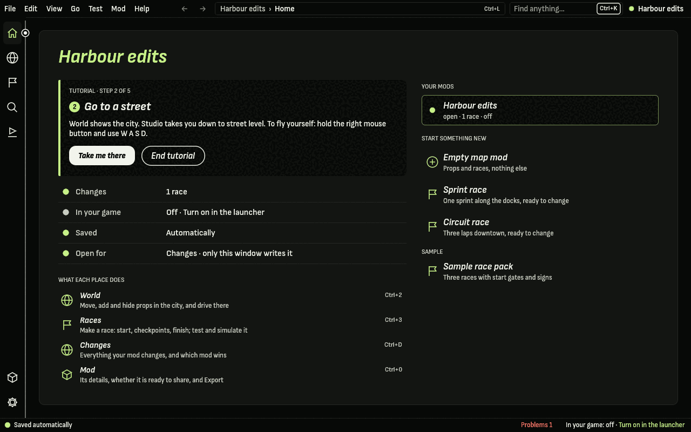
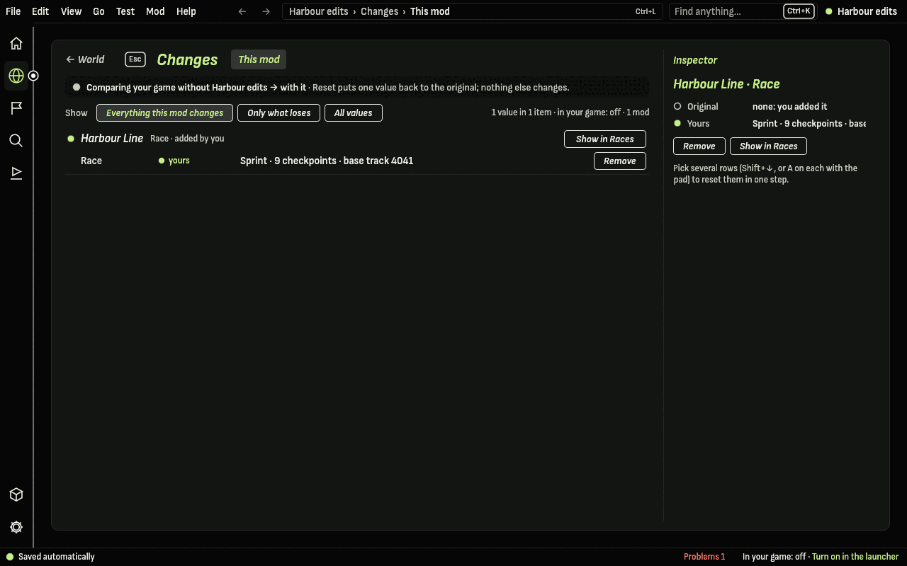

# From install to a shared mod

This page takes you from a fresh install to a map mod you can hand to a friend. It uses Overbright Studio, the
program for making mods. Each step links to the page that has the details.

You need Overbright installed and your own copy of the game set up in the launcher (the launcher's first screen
does this). Studio never changes the game's files or your career save.

## 1. Open Studio

1. Start the launcher. Open the **Dev** page and press **Open Studio (preview)**.
2. Studio opens on **Home**. From a terminal you can run `overbright-studio` instead.

More ways to start it are on [Getting started with Studio](studio-start.md).

## 2. Follow the first tutorial

On Home, under **Start here**, pick **Your first mod**. Press F1 at any time to do the step the card shows. The
tutorial has five steps:

1. **Make a mod.** A name, and Studio makes the folder.
2. **Go to a street.** The camera moves to street level in the city.
3. **Place a prop.** Drag one from the Prop browser, or let Studio place a cone where you look.
4. **Drive it.** The game starts at that spot with your mod loaded.
5. **Share it.** The Mod page, covered in step 6 below.

Each step ticks by itself when the mod shows it done. Ctrl+Z takes back any edit. The tutorials are described on
[Overbright Studio](studio.md#the-tutorials).

## 3. Make a race

Back on Home, pick **Make your first race**. It walks you through a base track, a start, checkpoints and a finish,
then tests the race with F5. Races need the game's own roads, so they need your game folder. The race tools are
on [Map editor and map mods](map-editor.md).

You can also start from a template: **Sprint race** or **Circuit race** under **Start something new**, or open the
**Sample race pack** to see three finished races.

## 4. See what your mod changes

Press Ctrl+D. **Changes** lists every value your mod gives, beside the original. If another mod gives the same
value, the page says which one wins. **Reset** gives one value back.

To look up a model or a texture by name, press Ctrl+4 for the **Browser**. To replay a simulated run, press
Ctrl+5 for **Runs**. Both are on [Overbright Studio](studio.md).

## 5. Test it

Press F5 to test a race, or Shift+F5 to drive from where you look. The test game stays open and takes your next
edit, so you can change a prop and look again.

## 6. Check it is ready

Press Ctrl+0 for the **Mod** page. Give the mod a name, an author and a short description. The **Ready to share**
list shows what still needs work, for example a race that has an error. Fix those first.

## 7. Share it

Press **Export** on the Mod page. You get one file. Steps for each way to share, and how a friend adds it, are on
[Share your mod as a pack](share-a-pack.md).

## Keys and pad

Everything works with a mouse, a keyboard or a pad. The key and pad table is in
[Keyboard and pad](studio.md#keyboard-and-pad). Help ▸ Controls in Studio shows the same table.

## If something goes wrong

- Studio says a mod will not read: the message names the file. Check it with
  `overbright-studio-cli checks run --mod <folder>` ([command-line tool](studio-cli.md)).
- A race will not test: it needs the game's race tracks, from the game folder the launcher set.
- Your work is saved as you go. The status bar says when it is.
